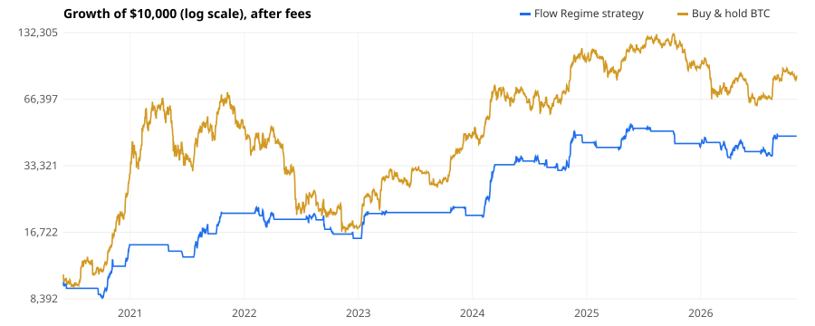
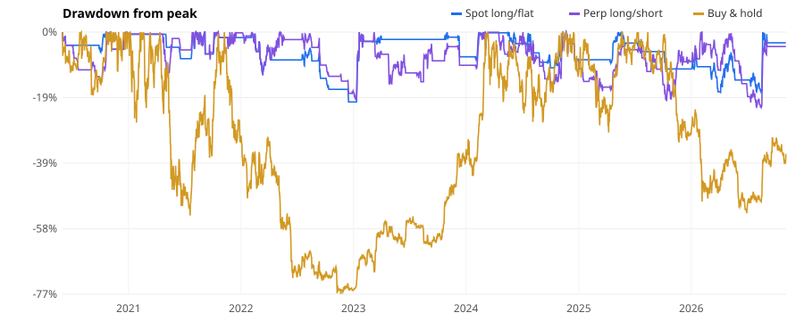

# BTC Flow Regime strategy: backtest report

_Generated by `research.py` on 2026-11-05 23:34 UTC. Data: Binance BTCUSDT perpetual + spot, 2019-12-31 → 2026-11-04, 15,000 × 4h bars. Educational research, not financial advice._

## 1. Headline results (fees 0.25% + slippage 0.05% per side, long/flat, no leverage)

| Period | Total | CAGR | Sharpe | Sortino | Max DD | Calmar | Trades | Win % | Profit factor | Time in market |
|---|---|---|---|---|---|---|---|---|---|---|
| Strategy: In-sample 2020-06 → 2022-12 | +57.1% | +19.1% | 0.85 | 0.63 | -28.1% | 0.68 | 15 | 33.3% | 1.71 | 24.7% |
| Buy & hold: In-sample 2020-06 → 2022-12 | +73.2% | +23.7% | 0.61 | 0.87 | -77.1% | 0.31 | 0 | n/a | n/a | n/a |
| Strategy: **Out-of-sample 2023-01 → now** | +188.2% | +31.7% | 1.26 | 1.25 | -30.7% | 1.03 | 24 | 41.7% | 2.08 | 30.6% |
| Buy & hold: **Out-of-sample 2023-01 → now** | +386.8% | +51.0% | 1.12 | 1.74 | -53.4% | 0.95 | 0 | n/a | n/a | n/a |
| Strategy: Full period | +352.8% | +26.5% | 1.10 | 0.96 | -30.7% | 0.86 | 39 | 38.5% | 1.99 | 28.2% |
| Buy & hold: Full period | +742.5% | +39.3% | 0.85 | 1.21 | -77.1% | 0.51 | 0 | n/a | n/a | n/a |

OOS Sharpe, 90% block-bootstrap interval: **0.18 – 2.15** (median 1.18; 98% of resamples > 0).

**How to read this:** buy-and-hold made more money, because 2020–2026 was a huge BTC bull run. The strategy's job is different. It aims to capture a good part of the upside while sitting in cash during sell-side regimes, which roughly halves the worst drawdown and gives better return per unit of risk. That is what makes it survivable, and what makes it scalable with sizing.

## 2. Calendar-year returns

| Year | Strategy | Buy & hold | Strategy max DD | B&H max DD | Trades |
|---|---|---|---|---|---|
| 2020 | +46.9% | +203.1% | -16.1% | -20.0% | 4 |
| 2021 | +38.6% | +57.7% | -11.9% | -54.2% | 4 |
| 2022 | -22.9% | -64.7% | -28.1% | -67.2% | 7 |
| 2023 | +26.8% | +156.0% | -9.5% | -21.3% | 4 |
| 2024 | +112.4% | +120.8% | -15.1% | -30.1% | 7 |
| 2025 | -4.0% | -6.6% | -21.7% | -34.4% | 6 |
| 2026 | +11.2% | -8.4% | -20.7% | -40.0% | 7 |

## 3. Walk-forward (parameters re-chosen every January using only past data)

Grid per refit: 72 combos (flow window, entry/exit thresholds, trend filter, stop width). Objective: in-sample Sharpe.

| Year traded | Chosen flow_n | entry/exit dev | trend filter | stop/trail ATR | Train Sharpe | Year return | Year Sharpe | Year max DD |
|---|---|---|---|---|---|---|---|---|
| 2022 | 126 | 0.0/-0.005 | True | 3.0/5.0 | 2.26 | -30.0% | -1.65 | -34.8% |
| 2023 | 126 | 0.01/-0.005 | False | 5.0/8.0 | 1.29 | +15.3% | 1.28 | -4.7% |
| 2024 | 84 | 0.005/-0.01 | True | 3.0/5.0 | 1.27 | +46.3% | 1.41 | -23.1% |
| 2025 | 84 | 0.005/-0.005 | True | 5.0/8.0 | 1.38 | -4.3% | -0.16 | -21.7% |
| 2026 | 126 | 0.01/-0.005 | False | 5.0/8.0 | 1.33 | +17.9% | 0.83 | -15.2% |

Stitched walk-forward 2022→now: CAGR **+6.1%**, Sharpe **0.38**, max DD **-34.8%**  (buy & hold same span: CAGR +11.9%, Sharpe 0.47, max DD -67.2%).

For comparison, the fixed default parameters over the same span: CAGR +18.0%, Sharpe 0.82, max DD -30.7%. Yearly re-optimisation chases noise; fixed, plateau-centred parameters were more stable.

## 4. Robustness: every configuration in the grid

108 configurations. Out-of-sample Sharpe > 0 in **100%** of them; median OOS Sharpe 0.94 (IQR 0.69–1.12). A strategy that only works at one magic setting is overfit. This one works across the grid.

| Parameter | Value | Mean IS Sharpe | Mean OOS Sharpe |
|---|---|---|---|
| `flow_n` | 42 | 0.48 | 0.61 |
| `flow_n` | 84 | 0.63 | 0.96 |
| `flow_n` | 126 | 0.81 | 1.15 |
| `entry_dev` | 0.0 | 0.55 | 0.77 |
| `entry_dev` | 0.005 | 0.65 | 0.94 |
| `entry_dev` | 0.01 | 0.72 | 1.01 |
| `exit_dev` | -0.01 | 0.72 | 0.90 |
| `exit_dev` | -0.005 | 0.68 | 0.94 |
| `exit_dev` | 0.0 | 0.52 | 0.88 |
| `spot_confirm` | False | 0.60 | 0.94 |
| `spot_confirm` | True | 0.68 | 0.88 |
| `trend_filter` | False | 0.65 | 0.91 |
| `trend_filter` | True | 0.63 | 0.90 |

## 5. Sensitivity (out-of-sample 2023 → now)

| Variation | OOS CAGR | OOS Sharpe | OOS max DD | Trades |
|---|---|---|---|---|
| **Default** (fee 25bp + slip 5bp) | +31.7% | 1.26 | -30.7% | 24 |
| Cheaper venue (fee 10bp + slip 2bp) | +34.5% | 1.35 | -29.1% | 24 |
| Harsh costs (fee 40bp + slip 10bp) | +28.7% | 1.16 | -32.5% | 24 |
| Flow signal 1 day stale (archive-only data) | +28.0% | 1.15 | -24.4% | 24 |
| Flow signal 2 days stale | +25.5% | 1.09 | -26.1% | 24 |
| Target vol 30% (more conservative) | +25.6% | 1.30 | -24.7% | 24 |
| Target vol 80% (≈ fully invested when long) | +31.2% | 1.20 | -32.7% | 24 |
| Tighter stops (3 / 5 ATR) | +15.8% | 0.76 | -32.9% | 42 |
| No stops (flow exit only) | +33.4% | 1.31 | -26.8% | 18 |
| Funding-crowding veto on (z > 2) | +30.7% | 1.23 | -32.7% | 24 |
| Long **and** short (perp venue) | +19.3% | 0.70 | -43.3% | 55 |
| Spot taker flow instead of perp flow | +11.3% | 0.54 | -34.7% | 36 |

## 6. Does order flow carry information? (rank IC vs next-20-day return, daily bars)

| Feature | IC 2020-22 | IC 2023-26 | Same sign? |
|---|---|---|---|
| `flow_imb` | +0.116 | +0.061 | yes |
| `flow_dev` | +0.092 | +0.049 | yes |
| `cvd_slope` | +0.105 | +0.050 | yes |
| `spot_imb` | -0.055 | +0.068 | **no** |
| `funding_z` | -0.013 | +0.049 | **no** |
| `momentum_7d` | +0.050 | -0.007 | **no** |
| `trend_vs_ema200` | +0.165 | -0.060 | **no** |

The flow features (`flow_imb`, `flow_dev`, `cvd_slope`) keep the same positive sign in both periods. Price trend and momentum flip sign after 2022, which is why the strategy is built on flow first and uses trend only as a filter.

## 7. Trade statistics (full period)

Trades 39 · win rate 38% · avg win +21.5% · avg loss -5.1% · best +69.0% · worst -9.3% · avg hold 17.0 days · exits: stop 25, signal 14

Low win rate with big winners is typical of trend/flow-following: most of the profit comes from a few long regimes. Expect strings of small losses.

## 8. Known limitations

- Backtests assume fills at the next 4h open plus slippage. Real fills, outages and Alpaca's BTC/USD price (vs Binance BTCUSDT signal data) will differ a little.
- The 2020–26 window is mostly a BTC bull market. A long/flat strategy can't profit in a long bear market; it can only sit in cash.
- 39 trades is a small sample. Treat every number as an estimate with wide error bars (see the bootstrap interval).
- Some design choices (wide disaster stops, volatility-target sizing, dropping the funding veto) were made after seeing 2023+ results, so the fixed-parameter OOS numbers are somewhat optimistic. The walk-forward in section 3 is the more honest estimate, and it is clearly weaker: re-optimising each year picked noisy settings (e.g. tight stops in 2022). The result that holds in every test is the **drawdown reduction** compared with buy-and-hold.
- Market structure changes. Re-run this report every few months and stop the bot if live results drift well outside the backtested drawdown.
